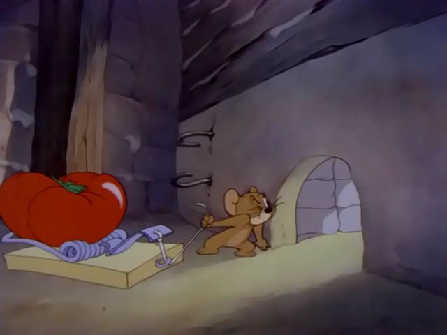

# Etapa actual — stages 1–5

Actualizado: 2026-09-10. Etapa inicial completada según confirmación del Lead; se conserva como historial.

## Meta

Terminar cinco etapas jugables y conectadas dentro de una pared, con escala de rata y ambiente inspirado en el interior de Tom y Jerry. El curso construido por el Lead **es una base totalmente modificable**, no un layout final. Se pueden cambiar rutas, alturas, plataformas y assets; prueben con la rata real.

| Frente | Coordina | Colaboración | Prioridad |
|---|---|---|---|
| G1-01: recorrido y plataformas | Enrico | Machuc; apoyo puntual de Vekator | Máxima |
| G1-02: checkpoints, hazards, hitboxes y UI | Dhrystone | Vekator | Alta; paralelo a plataformas |
| G1-03: ambiente dentro de la pared | Machuc | Aportes del equipo | Después de apoyar plataformas; por secciones |
| G1-04: integración y playtest | Vekator | Dhrystone | Pruebas parciales desde el inicio; cierre al final |

El Lead trabaja por separado en colección/economía y conserva la decisión final. No se le asigna el frente de integración. Enrico se concentra en el recorrido; Vekator no es requisito para cada decisión visual.

## Base real y pendientes

Ya existe un greybox de cinco etapas, modelo de rata animado y HUD. No se parte de cero. El handoff reporta una regresión de checkpoints y fixes de respawn/suelo pendientes de validación humana; la causa todavía debe reproducirse. No anunciar estos sistemas como terminados por tener scripts o una captura.

Checkpoints inician etapas: spawn=1, siguiente pad=2…5; la meta termina Stage 5, no crea Stage 6. SafeFloor devuelve sin matar; hazard/RESET sí implica muerte y respawn. Cambiar esas reglas requiere acordarlo primero.

Hay candidatos de assets revisados por el Lead (Kenney/KayKit). Pedirle modelos/previews disponibles antes de repetir una búsqueda grande. Registrar fuente y permiso de uso de lo que incorporen; revisar scripts de terceros. La imagen de Tom y Jerry es referencia de ambiente, no un asset para importar al juego.

## Cómo avanzamos

1. Abran **Frentes del equipo** en #tareas y lean el contexto del ticket.
2. Responsable o colaborador inicia el frente. Acuerden qué sección/Script edita cada persona.
3. Compartan una sección jugable y pruebas parciales en el mismo ticket; ajusten juntos antes de extenderla.
4. Todos pueden aportar y comentar reviews. **Entregar tarea** solicita la revisión final, sin formulario obligatorio.
5. Solo el Lead aprueba/cierra o devuelve a trabajo con feedback. La evidencia permanece en Historial.

Todos trabajan en Studio. Solo el Lead usa Rojo y se adapta al trabajo compartido. Antes de editar un Script que esté sincronizando, avisen para evitar sobrescrituras; no necesitan instalar herramientas extra ni copiar rutas Linux.

## Dependencias sin bloquear colaboración

G1-01 y G1-02 avanzan juntos; para aprobar G1-01, G1-02 debe estar Done. Machuc puede preparar ambiente, pero primero apoya la ruta. G1-04 puede probar avances desde ahora; su cierre requiere G1-01, G1-02 y G1-03 Done. No se exige cerrar un ticket por cada avance.

Dhrystone y Vekator investigan balancearse/agarrarse/soltarse de una cuerda **después de estabilizar la base**, en una prueba aislada. Decidir con evidencia si se integra o se aplaza es válido; integrarla no bloquea los cinco stages.

## Criterio de etapa terminada

Recorrido 1→5 comprensible y divertido con la rata; colisiones justas, checkpoints/respawn y progreso independiente; ambiente que no obstruya cámara/lectura; pruebas en PC y móvil y con dos clientes; ningún bloqueo de recorrido conocido; aprobación del Lead. Un resultado no probado se declara pendiente, nunca Done automático.

## Recursos puntuales

- [Colisiones — Roblox](https://create.roblox.com/docs/workspace/collisions)
- [Armar una biblioteca de assets — Roblox](https://create.roblox.com/docs/tutorials/curriculums/environmental-art/assemble-an-asset-library)
- [Testing en Studio — Roblox](https://create.roblox.com/docs/studio/testing-modes)
- [RopeConstraint — Roblox](https://create.roblox.com/docs/physics/constraints/rope)
- [Seguridad de assets de terceros — Roblox](https://create.roblox.com/docs/scripting/security/third-party-vulnerabilities)

La tarea completa de cada frente conserva objetivo, propuesta de trabajo, dependencias, fuentes y criterios de cierre en su ticket. No imponemos una construcción paso a paso: el equipo propone, prueba y mejora.

## Referencia visual aportada por el Lead

Usen escala, materiales y composición como referencia; el personaje de la imagen no forma parte de nuestro diseño.
